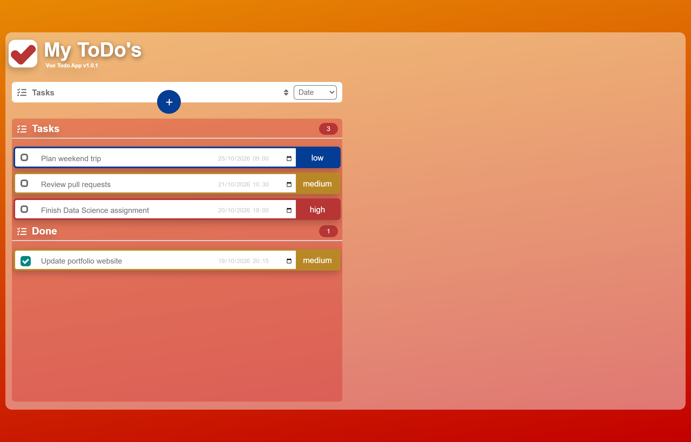
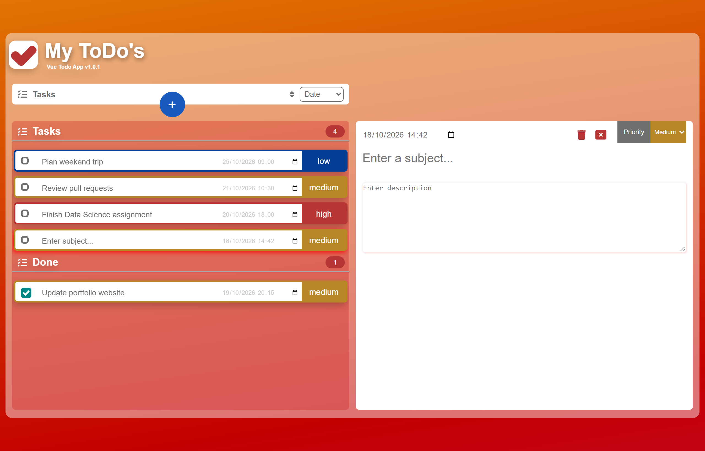
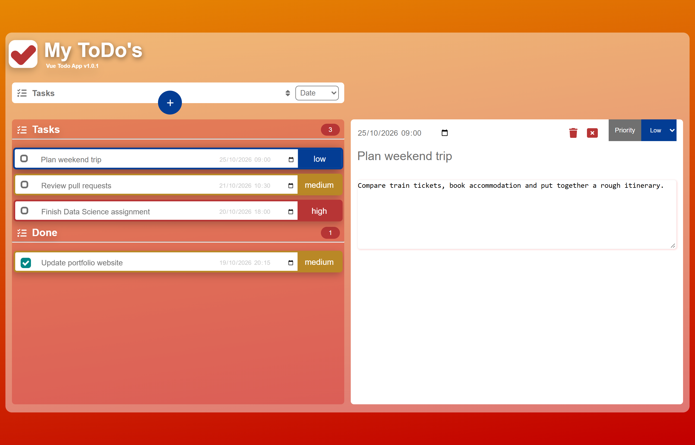
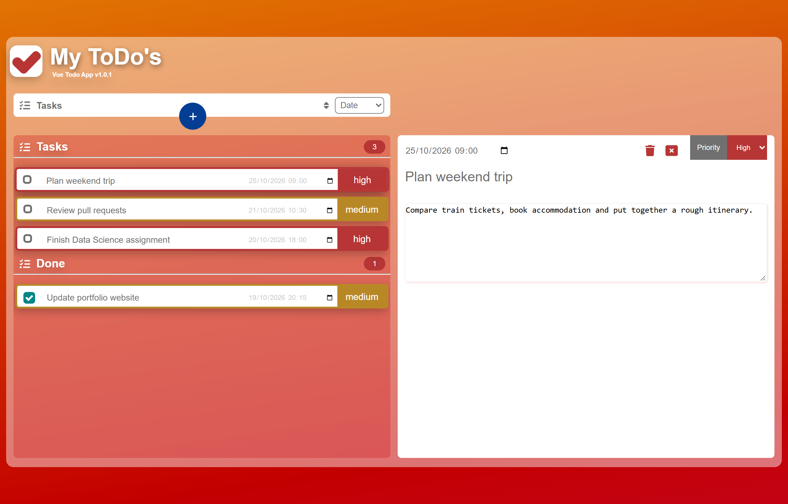
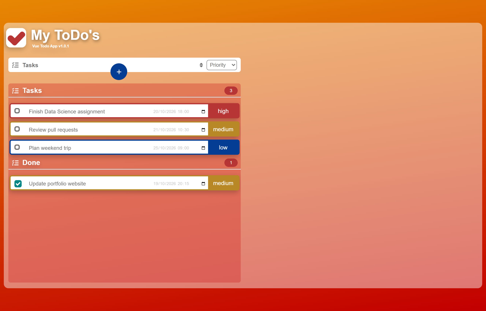
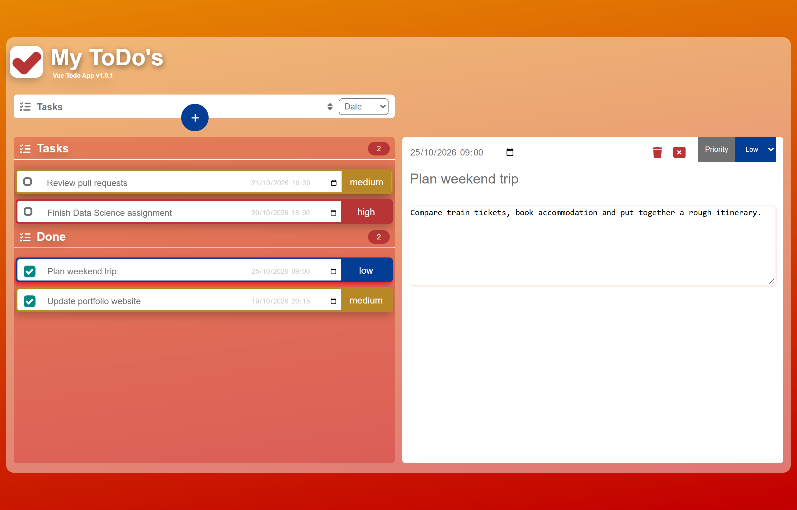
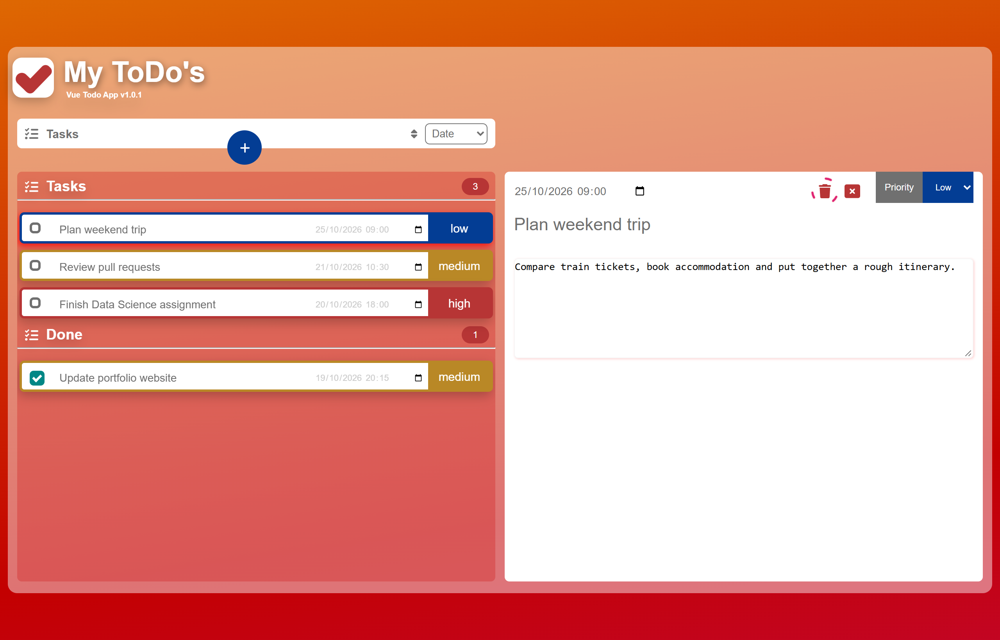
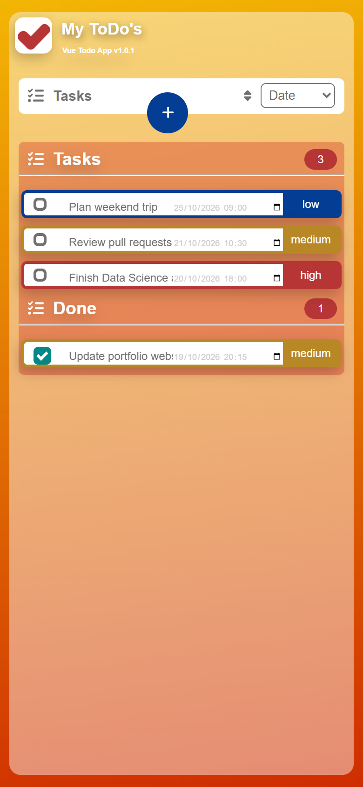
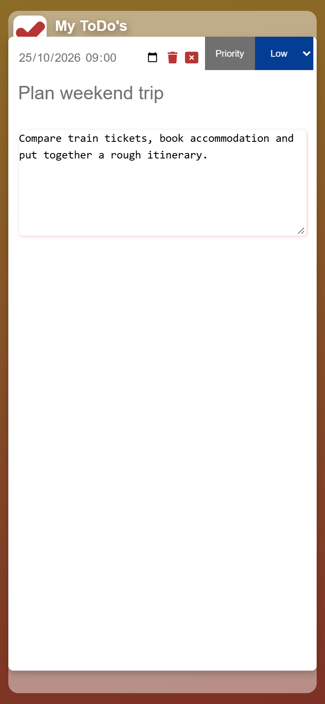
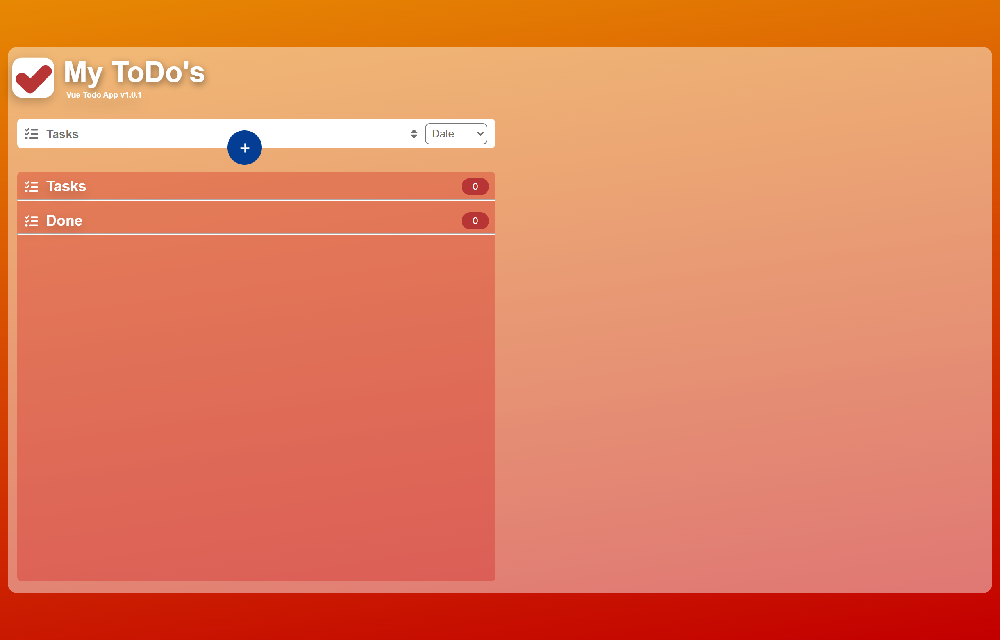

<div align="center">

# ✅ Vue Todo App

**A simple and responsive Vue 3 to-do application for managing tasks efficiently.**

[](https://reza-nzri.github.io/vue-todo-app/)
[](https://github.com/reza-nzri/vue-todo-app/actions/workflows/deploy-pages.yml)

[](https://vuejs.org/)
[](https://www.typescriptlang.org/)
[](https://vitejs.dev/)
[](https://pinia.vuejs.org/)
[](https://sass-lang.com/)
[](https://www.npmjs.com/)
[](https://prettier.io/)

**🌐 [reza-nzri.github.io/vue-todo-app](https://reza-nzri.github.io/vue-todo-app/)**

</div>

---

## 🏢 Project Origin

> This project was built at **Intentive GmbH** as an **internship starter project**.
>
> The entire application — architecture, components, state management, styling and
> responsive behaviour — was **written by hand, without any AI assistance**. No code
> generation tools, no AI pair-programming, no copied scaffolding beyond the standard
> `create-vue` starter. It exists as a deliberate learning exercise in the Vue ecosystem.

---

## 🎯 Description

The `vue-todo-app` repository is a **task management application**, a productivity tool created to practice and learn the `Vue` Framework.
\
An application that allows you to list your pending tasks, both on a personal level for "shopping" or "reminders" and on a professional level to manage your projects.

---

<details open>
<summary><h2>📸 Features & Screenshots</h2></summary>

All screenshots below are captured from the **production build** — the exact bundle that is deployed to GitHub Pages.

<details open>
<summary><h3>🗂️ Task overview — two panels, live counters</h3></summary>

Open tasks and completed tasks live in separate panels, each with a counter badge. Every row is colour-coded by priority (🔴 high · 🟠 medium · 🔵 low).



</details>

<details>
<summary><h3>➕ Adding a task</h3></summary>

The round **+** button creates a new task with sensible defaults (`medium` priority, current timestamp) and immediately opens its detail panel so you can start typing.



</details>

<details>
<summary><h3>📝 Task details — subject, description, due date</h3></summary>

Selecting a task opens the detail panel. Subject and description are editable inline, the due date uses the native date-time picker, and every change is persisted immediately.



</details>

<details>
<summary><h3>🚦 Priority levels</h3></summary>

Priority is changed from the dropdown in the detail panel. The control, the task border and the task badge all recolour together, so priority is readable at a glance from the list.



</details>

<details>
<summary><h3>🔀 Sorting</h3></summary>

Tasks can be sorted by **Date**, **Priority** or **Subject**, and the arrow icon flips between ascending and descending order. Sorting re-applies automatically whenever the task list changes.



</details>

<details>
<summary><h3>✔️ Completing a task</h3></summary>

Ticking the custom checkbox moves the task from **Tasks** into the **Done** panel and updates both counters.



</details>

<details>
<summary><h3>🗑️ Hold-to-delete</h3></summary>

Deletion is intentionally not a single click. Holding the trash icon starts an animated progress ring; releasing early cancels, which prevents accidental data loss.



</details>

<details>
<summary><h3>📱 Responsive layout</h3></summary>

Below 888 px the two-column grid collapses into a single column.



On small screens the detail view is presented as a centred popup over a dimmed backdrop, closable with the ✕ button, the `Esc` key, or a click outside.



</details>

<details>
<summary><h3>🫙 Empty state</h3></summary>

A fresh install starts with no tasks — state lives in `localStorage`, so your tasks survive a reload without any backend.



</details>

</details>

---

<details>
<summary><h2>🏗️ Developed with</h2></summary>

| Area | Stack |
| --- | --- |
| Framework | Vue 3 (`<script setup>`, Composition API) |
| Language | TypeScript |
| Build tool | Vite 5 |
| State | Pinia + `@vueuse/core` `useLocalStorage` |
| Styling | CSS / Sass, BEM-ish naming conventions |
| Icons | FontAwesome |
| Tooling | ESLint, Prettier, Vitest |
| CI/CD | GitHub Actions → GitHub Pages |

[](https://www.npmjs.com/)
[](https://prettier.io/)

</details>

---

<details>
<summary><h2>🚀 Deployment</h2></summary>

The app is deployed automatically to **GitHub Pages** by
[`.github/workflows/deploy-pages.yml`](.github/workflows/deploy-pages.yml) on every push to `main`.

The workflow:

1. installs dependencies with `npm ci`,
2. recreates the gitignored `.env` from `.env.example`, forcing `VITE_APP_ENV=production`,
3. stamps the version from `.pvnr` via `getVersion.js`,
4. builds with `npm run build-only`,
5. uploads `dist/` and publishes it to Pages.

> ⚠️ **Why `VITE_APP_ENV=production` matters in CI**
> In development mode the store calls `loadDummyTasks()` on every startup, which
> overwrites `localStorage`. Shipping a development build to Pages would therefore
> reset every visitor's tasks on each page load.

A manual run can be triggered from the **Actions** tab (`workflow_dispatch`).

</details>

---

<details>
<summary><h2>🔖 Changelog | Tags versions <code>vue-todo-app</code></h2></summary>

**Sorted by:** latest version on top

### [v1.0.1] - 2024-08-09
#### Added
Uses:
- Fix path construction in getVersion.js for Windows compatibility
- Update version in dev branch
- Fix the build process
- Change package.json for deploy

### [v1.0.0] - 2024-07-29
#### Added
- Basic CRUD functionality for managing tasks.
- Responsive design compatible with mobile and desktop.
- Integration with Pinia for state management.
- FontAwesome icons added for UI elements.
- Dummy tasks loaded in development mode for testing purposes.

### [v0.1.0] - 2024-06-20
#### Added
- Initial release of `vue-todo-app`.

</details>

---

<details>
<summary><h2>🛠️ Commands & Development Setup</h2></summary>

### Using `Default Tasks json` in Development Mode

To help you get started quickly, we have included a set of default tasks that will be used in `development mode`. Follow the steps below to **set up your environment**:

1. **Clone the Repository**:
```sh
   git clone https://git2.intentive.de/training-and-internship/internship-reza-nazari/vue-todo-app.git
   cd vue-todo-app
```

2. **Install Dependencies**:
```sh
npm install
```

3. **Set Up Environment Variables**:
Create a `.env` file in the root directory of your project. You can use the provided `.env.example` file as a template.
```sh
cp .env.example .env
```

4. **Ensure `VITE_APP_ENV` is Set to `development`** :
Open the `.env` file and make sure the `VITE_APP_ENV` variable is set to `development`.

```sh
VITE_APP_ENV=development
```

5. **Run the Development Server** :
Start the development server to see the default tasks in action.
```sh
npm run dev
```

### Default Tasks
In development mode, the application will load a set of default tasks defined in `public/dummyTasks.json`. These tasks provide a quick way to see how the application behaves with initial data. If you need to modify the default tasks, you can edit the `public/dummyTasks.json` file.

### Additional Notes
- Ensure your `.env` file is not committed to the repository by keeping it listed in `.gitignore`.
- For production, you can remove the `VITE_APP_ENV` variable or set it to `production` to disable loading default tasks.

</details>

---

<details>
<summary><h2>📄 Markdown Files Contents List</h2></summary>

1. [Solve Possible Problems](src/assets/README/01_solve_possibe_problems.md)
2. [Daily Tasks](src/assets/README/02_daily_tasks.md)
3. [CSS Class Names Conventions](src/assets/README/03_css_class_names_conventions.md)
4. [Async vs Await](src/assets/README/04_async_vs_await.md)
5.

</details>

---

<details>
<summary><h2>⚙️ Project Config Files</h2></summary>

### Create `.nvmrc` Version File

A configuration file used in Node. js projects to stores the current Node.js version in the `.nvmrc` file (Node Version Manager), which can be used by `nvm` (Node Version Manager) to load the correct Node version for your project.

```sh
node --version > .nvmrc
```

### Create `.pvnr` File

Current used project version number

```sh
echo 0.1.0 > .pvnr
```

</details>

---

<details>
<summary><h2>📂 <a href="folder-structure.tree">Folder Structure</a></h2></summary>

```bash
tree /F /A > folder-structure.md
tree --gitignore > folder-structure.txt

# Run the tree command and exclude the directories manually
tree /F | Out-File -FilePath folder-structure.md


# Run the tree command excluding specific directories (using `findstr` to filter out lines)
tree /F | findstr /V /C:".idea" /C:"venv" /C:\Users\reza.nazari\Desktop\WorkDesk\GitLab\develop\python-image-comparison\lfw" > folder-structure.md
```

### Use [`structure-codes/cli`](https://github.com/structure-codes/cli) to generate a structure file

```bash
struct -i dist -o folder-structure.tree
```

#### Use this `Tree: CTC.vscode-tree-extension` VS Code Extension

</details>

---

<details>
<summary><h2>🧩 My personal .vscode configs</h2></summary>

### .vscode/extensions.json

```bash
{
  "recommendations": [
    "Vue.volar",
    "dbaeumer.vscode-eslint",
    "esbenp.prettier-vscode"
  ]
}
```

### .vscode/settings.json

```bash
{
    "prettier.configPath": "./.prettierrc.json",
    "editor.formatOnSave": true,
    "editor.defaultFormatter": "esbenp.prettier-vscode"
}
```

### My VS Code Extensions

- CSS Tree
- Auto Rename Tag
- Auto Rename Tags
- Material Icon Theme
- WSL
- Git Graph
- Git History
- Auto Import
-

</details>

---

<details>
<summary><h2>🧠 Prop Drilling & Open Questions</h2></summary>

## ❓🤔 Questions

1. Verwendung von Classes and Modules
2. wird `<script>` unten oder oben von code benutz?


</details>

---

<details>
<summary><h2>📘 Document of the working method</h2></summary>

wie kann ich methode oder functions habe damit ich neue task instance object erstellen und alle crude methode such as delete add update get usw haben kann und wo anders sie nutzen kann? z.b. möchte in TopBar wenn man auf auf button add-button clickt dann neue task erstellen kann mit v-model und sollte die prop openDisplay: auf true gesezen werden und deswegen nur die inhalte von diesem task in TaskDetails aufgemacht und angezeigt werden und dabei automatisch die priority: "medium" und neue autoincrement id und subject: immer auf "Enter a new subject..." und description: "Entere a new description " und dueDateTime: immer auf 5 min später als aktuelle datum und completed: auf false setzen.

list-board ist nur für display.
der user darf jeder zeit eine extestierete task aufmachen (nicht gleichzeitig. nur eine ) und dann nur in TaskDetails die task props (nur dieser props: subject, description, dueDateTime, priority) ändern zu können.

die tasks werden in zwei bereiche angezeigt, öffene tasks in tasks-dashboard und fertige tasks in done-dashboard.

wenn man auf checkbox clickt und isChecked true ist, dann muss completed auf true gesezen werden und gliechzeitig dynamic diser entsprechende task in done-dashboard angezeigt werden.
alle tasks in done-dashboard bekommen einen filter gray mit opacity als zeichen für fertig und erledigt.

wenn man in TaskDetails> auf icon="fa-solid fa-calendar-days" clickt dann sollte dieser classic kalender date picker angeigt werden und da kann man date yyyy-mm-dd und Uhrzeit hh:mm:ss auswählen und in dueDateTime: "2023.08.24 - 08:51:30", mit genau diesem format die daten speichern.

man kann mit TaskDetails> priority-dropdown gehen und den priority ändern und in priority: "ausgewählte priority aus drop down menue" speichern.

</details>

---

<details>
<summary><h2>🌿 Git Cheatsheet</h2></summary>

### Delete Branch

```bash
git branch -d <branch-name>  # Use -D if needed

git push origin --delete <branch-name>    # Delete a Branch Remotely (Optional)

# Push Changes to the Remote Repository
git push origin <branch-name>
```

### Compare Branches

```bash
git diff branch1..branch2

# Viewing Differences
git diff branch1..branch2 -- path/to/file
```

</details>

---

<details>
<summary><h2>🎨 CSS, Breakpoints & SASS</h2></summary>

### [Breakpoints](https://getbootstrap.com/docs/5.0/layout/breakpoints/)

customizable widths that determine how your responsive layout behaves across device or viewport sizes in Bootstrap.

### CSS Converntions

Vermeide ID-Selektoren; Wähle eine Konvention und halte dich daran und sag mir die name davon, welche du genommen hast;  Verwende Hilfsklassen wie .text-center, .m-0; Meide übermäßige Verschachtelung: Halte CSS-Selektoren so flach wie möglich; nutze SMACSS, OOCSS, BEM muss auf jeden fall benutzt werden

### SASS

Install

```bash
npm install -D sass sass-loader@10
```

</details>

---

<div align="center">

🌐 **[Open the live app](https://reza-nzri.github.io/vue-todo-app/)** · 🐙 **[github.com/reza-nzri](https://github.com/reza-nzri)**

</div>
